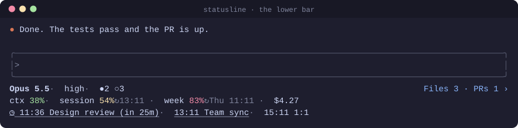

# claude-mods

Mods for Claude Code in the terminal.

| Mod | What it does |
| --- | --- |
| `activity-pane` | A Files pane with the diffs and PRs of the session. In replies: `▶ Run` under each bash block, `▶ Run → Claude` to run it and send the output to the model, `↑ Send to Claude` after a plain run, Mermaid drawn as ASCII, tables redrawn to fit, and copy buttons. A footer file for the status line with today's meetings (Google Calendar connector). |
| `statusline` | A status line script for the lower bar, see [Status line](#status-line). |
| `job-tags` | Puts a category (code, review, data, meeting, research, general) before each background job's name, from its first prompt, and names the job again after `/clear`. |

## Demos

### activity-pane: Run → Claude

`▶ Run → Claude` runs the block and sends the output to the model, which then replies to it.



### activity-pane: Files pane

The `Files 3 · PRs 1 ›` button at the end of the mode line opens the pane: the PRs of the session, the files changed, and a diff for each.



### statusline

Model, effort and sessions; usage with reset times and cost; today's meetings as links. Drawn by `statusline/statusline.ts` from sample data.



### job-tags



The demos are drawn from sample data by `bun demos/build.ts`.

## Install

At the prompt of a terminal session:

```
/plugin install activity-pane --marketplace leonemendes/claude-mods
```

```
/plugin install job-tags --marketplace leonemendes/claude-mods
```

From a shell:

```bash
claude plugin install activity-pane --marketplace leonemendes/claude-mods
```

```bash
claude plugin install job-tags --marketplace leonemendes/claude-mods
```

In the desktop app, where `/plugin` does not run: click + next to the prompt box, then Plugins, Add marketplace with `leonemendes/claude-mods`, then Add plugin.

## Status line

`statusline/statusline.ts` draws the lower bar in up to three lines: the model, effort and how many sessions are running or waiting; context, session and week usage with reset times, and cost; and today's meetings with join links, from the footer file `activity-pane` writes. It keeps room for the pane's Files button and shows one line when the pane is open. It needs [bun](https://bun.sh).

Copy the folder to your Claude config:

```bash
git clone https://github.com/leonemendes/claude-mods.git /tmp/claude-mods && cp /tmp/claude-mods/statusline/*.ts ~/.claude/
```

Then add this to `~/.claude/settings.json`:

```json
"statusLine": { "type": "command", "command": "$HOME/.claude/statusline.ts" }
```

## Develop

```bash
claude plugin validate activity-pane
```

```bash
claude plugin test activity-pane
```
